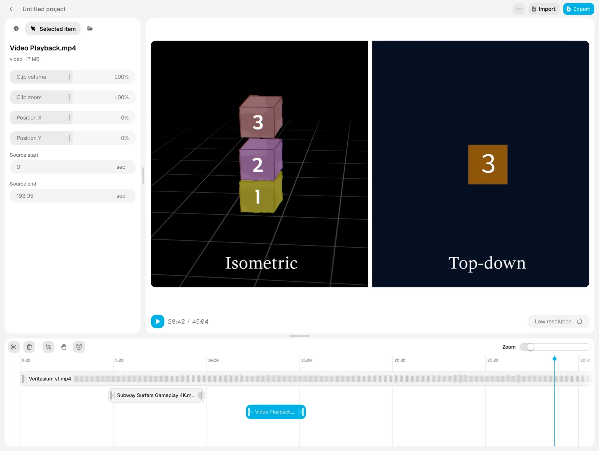

# Local Video Editor

A local-first video editor that runs in your browser. Import, arrange, trim,
preview, and export video and audio without uploading source files to a server.
No account or application backend is required.

[Try the editor](https://localvideoeditor.com) ·
[Report a bug or suggest a feature](https://github.com/Thimows/local-video-editor/issues)



## Features

- Import local video and audio with the file picker or drag and drop.
- Arrange and trim clips on a multi-track timeline.
- Adjust clip volume, scale, and position, and mix separate music tracks.
- Preview edits using local media and generated preview proxies.
- Export MP4 or WebM with configurable resolution, frame rate, and compression.
- Automatically save projects and undo history in the browser.
- Continue editing offline once the production application and project routes
  have been cached.

## Browser support and limitations

Use a current desktop Chromium-based browser, such as Chrome or Edge, for the
best support. The editor relies on WebCodecs, the File System Access API,
IndexedDB, and the Origin Private File System (OPFS). Codec support depends on
your browser, operating system, and hardware; a supported file extension does
not guarantee that its video or audio codec can be decoded or exported.

Projects belong to the browser profile and site origin where they were created.
They do not sync across devices, browsers, or different deployments. Clearing
site data can delete projects and cached media. Keep your original media files;
the browser may ask you to reconnect files or grant file access after reopening
a project. Browser storage is not a backup.

Large projects and high-resolution exports can require substantial memory,
processing time, and local storage. Keep the editor open while exporting.

## Run locally

You need Git, Node.js **24.22.1**, and npm **12.2.1**. The Node version is pinned
in `.nvmrc` and `.node-version`. With [nvm](https://github.com/nvm-sh/nvm):

```bash
git clone https://github.com/Thimows/local-video-editor.git
cd local-video-editor
nvm install
nvm use
npm install --global npm@12.2.1
npm ci
npm run dev
```

Open [localhost:3000](http://localhost:3000), or the address printed in your
terminal. Run all workspace commands from the repository root. No API keys,
accounts, database setup, or environment variables are needed.

The service worker is enabled only in production, so development mode does not
provide the production offline experience.

## Build and self-host

```bash
npm run build
npm run start --workspace=web
```

The web application lives in `apps/web` and uses Next.js. Deploy it to a host
that supports a Next.js Node.js application, using Node 24.x and the pinned npm
version. Use HTTPS outside localhost so browser storage, file access, and
service workers can work in a secure context.

For your own domain, optionally set `NEXT_PUBLIC_SITE_URL` to your absolute site
URL before building. It controls metadata, the sitemap, and robots output;
the default is `https://localvideoeditor.com`. For local configuration, place it
in `apps/web/.env.local`, which is ignored by Git:

```dotenv
NEXT_PUBLIC_SITE_URL=https://your-editor.example
```

Dependencies and the Geist font loaded through `next/font/google` need network
access during installation or build. Offline editing applies to the cached
production application, not the initial installation or build.

## How it works

1. **Import:** the browser opens local files and reads their metadata. Runtime
   object URLs provide access to media without an upload step.
2. **Edit:** timeline edits update the local project. IndexedDB stores project
   data, undo history, file handles, and eligible browser-local file blobs.
3. **Preview:** local media and segmented preview proxies provide playback.
   Generated proxies are cached in OPFS; waveforms are generated locally.
4. **Export:** WebCodecs, Canvas, Web Audio, and Mediabunny compose video, mix
   audio, encode, and mux the output on the device. Temporary export data uses
   browser-local storage.
5. **Reopen:** the editor restores the saved project and reconnects local files
   where permissions and browser support allow. The production service worker
   caches application resources and project routes for subsequent offline use.

The editor has no media upload pipeline, mandatory account system, or analytics
integration. Feedback opens GitHub Issues in a separate tab, which requires an
internet connection. Local file and preview diagnostics run only in development;
production builds do not populate their debug globals or log preview metadata.

## Development

The workspace uses Next.js 16, React 19, TypeScript 6, Tailwind CSS 4, and
Turborepo with npm workspaces. All application and shared component icons use
Tabler Icons; there is no icon-library switcher.

| Command | Purpose |
| --- | --- |
| `npm run dev` | Start the development application |
| `npm run build` | Build the workspace for production |
| `npm run start --workspace=web` | Serve the built web application |
| `npm run typecheck` | Check TypeScript across the workspace |
| `npm run lint` | Run ESLint across the workspace |
| `npm run check` | Run lint and TypeScript checks together |
| `npm run format` | Format workspace source files |

Use targeted lint or type checks while iterating. Run `npm run check` for larger
or error-prone changes. Read [AGENTS.md](AGENTS.md) for repository instructions,
including the requirement to consult the installed Next.js documentation before
framework changes.

### Code map

| Location | Responsibility |
| --- | --- |
| `apps/web/src/app/` | Landing page, project list, editor routes, and metadata |
| `apps/web/src/components/editor/editor-client.tsx` | Editor UI, timeline interactions, preview coordination, and export workflow |
| `apps/web/src/components/projects/projects-client.tsx` | Project creation and management |
| `apps/web/src/lib/editor/types.ts` | Project, media asset, timeline, and export types |
| `apps/web/src/lib/editor/db.ts` | IndexedDB persistence and undo history |
| `apps/web/src/lib/editor/media.ts` | Import, file metadata, permissions, and file restoration |
| `apps/web/src/lib/editor/preview-proxy.ts` | Segmented local preview proxies |
| `apps/web/src/lib/editor/waveform.ts` | Waveform generation and caching |
| `apps/web/src/lib/editor/render-engine/` | Video composition, audio mixing, encoding, muxing, and output |
| `apps/web/public/sw.js` | Production offline caching |
| `packages/ui/` | Shared UI components, styles, icons, and interaction primitives |
| `packages/eslint-config/` | Shared lint configuration |
| `packages/typescript-config/` | Shared TypeScript configuration |

See [the browser architecture notes](docs/local-first-browser-research.md) for
background on the local-first design.

### Promotion slot

The editor sidebar has a configurable promotion slot, disabled by default.
Its content is a neutral placeholder. To use it, edit
`apps/web/src/lib/editor/promotion.ts`: replace the name, ID, destination URL,
local icon paths, and taglines, then set `enabled` to `true` and rebuild.
Keep it disabled to hide the card without leaving an empty slot.

## Feedback and contributions

Use [GitHub Issues](https://github.com/Thimows/local-video-editor/issues) for bug
reports, feature requests, and questions. Include reproduction steps, browser and
OS versions, and relevant codec or export settings for media issues. Avoid
posting private media or filenames; a small non-sensitive sample is preferable.
The application's feedback menu opens the same issue tracker.

Keep contributions focused and preserve local processing and clear browser
compatibility errors. Discuss substantial changes in an issue first.

## License status

A repository-wide license has not been selected yet. Third-party dependencies
and copied assets retain their own licenses; making this repository public does
not relicense them. See [the license review](docs/license-review.md) for the
remaining release decisions. [Third-party notices](THIRD_PARTY_NOTICES.md) record
the verified PixelBlast source, Lina adaptations, and bundled font licenses.
Full notices are also served at `/third-party-notices.txt`.
